# OpenMacros+

**English** | [Português (Brasil)](README.pt-BR.md)

A free, independent alternative to Logi Options+ for Linux. It configures Logitech HID++ 2.0 mice and keyboards.

[](https://github.com/J3sussh/OpenMacros/actions/workflows/ci.yml)
[](LICENSE)
[](pyproject.toml)

> **Not affiliated with Logitech.** OpenMacros+ is an independent project. It is not made, endorsed or sponsored by Logitech. See [Trademarks](#trademarks).

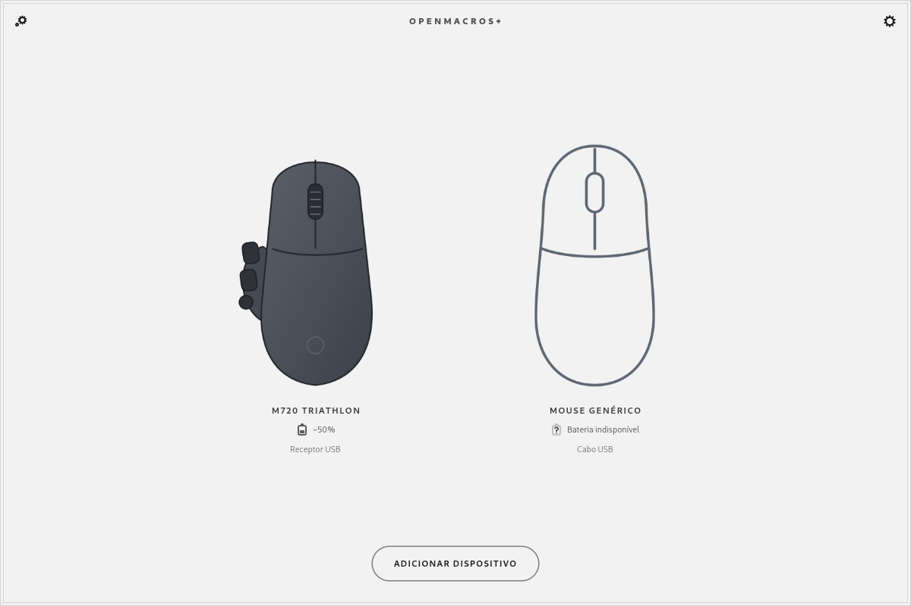

|                                                                                  |                                                                            |
| -------------------------------------------------------------------------------- | -------------------------------------------------------------------------- |
| 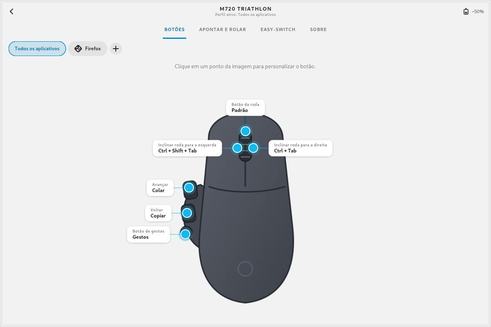<br>Buttons                              | 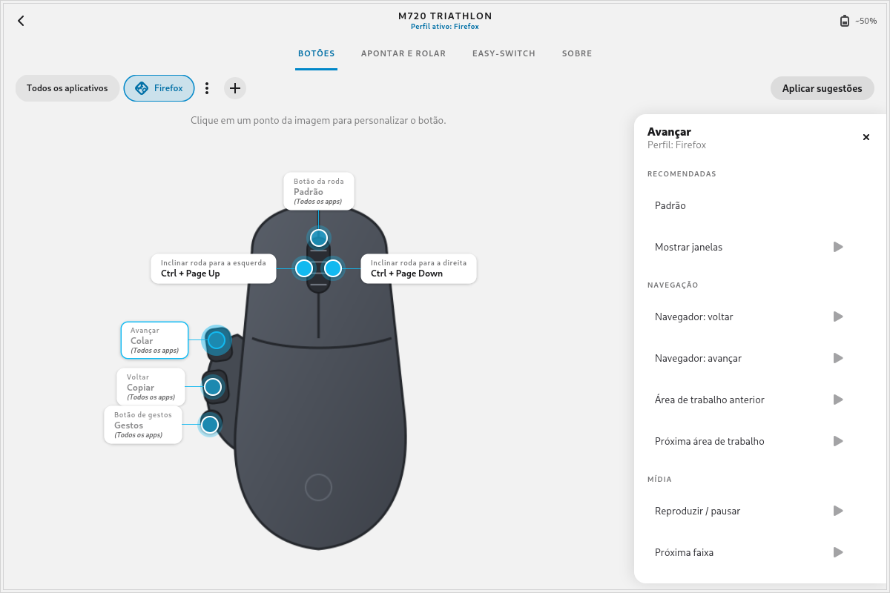<br>Per-app profiles |
| 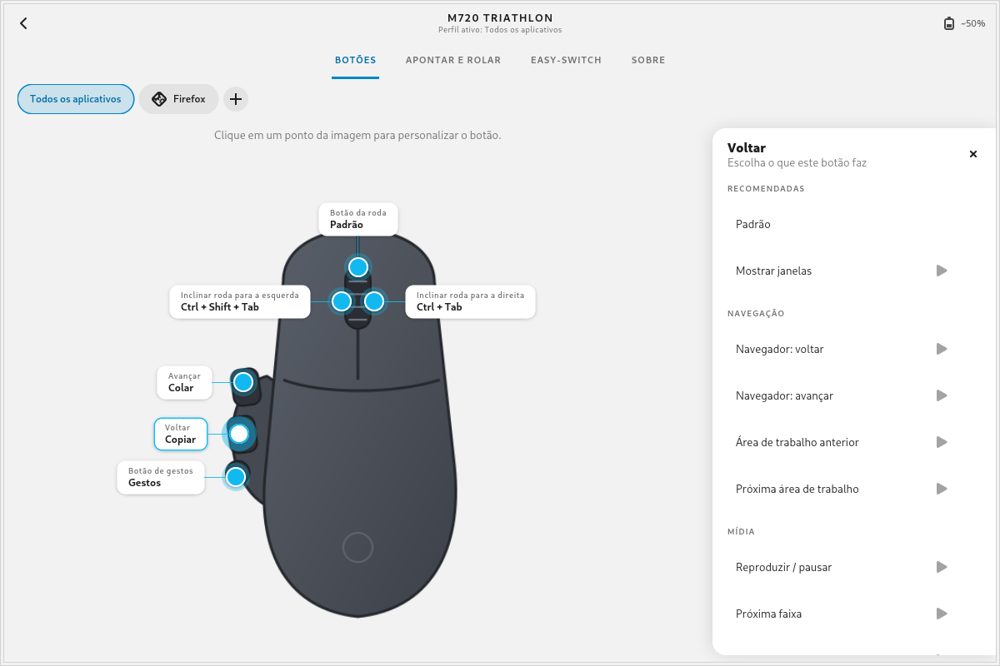<br>Action panel               | 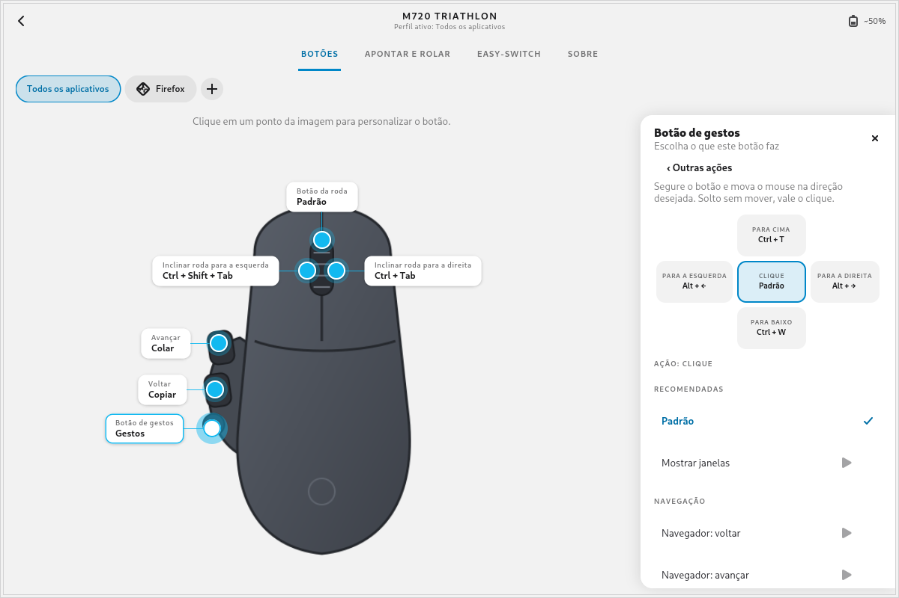<br>Gestures                     |
| 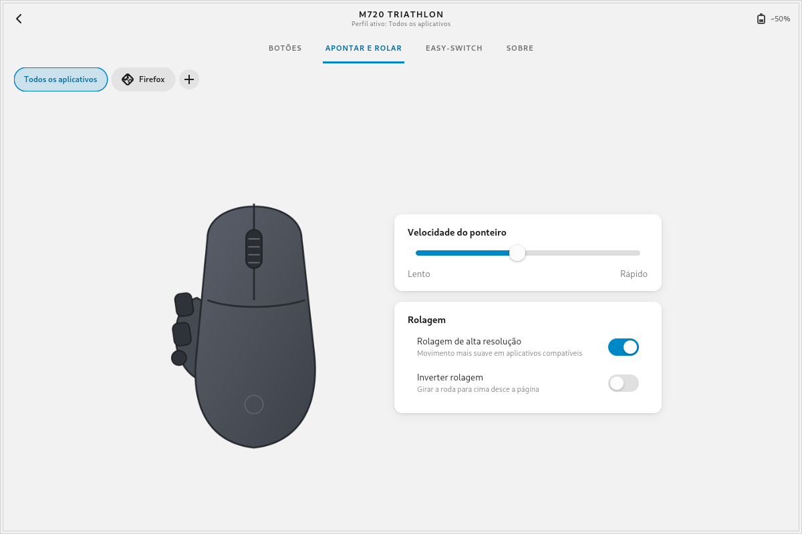<br>Point and scroll            | 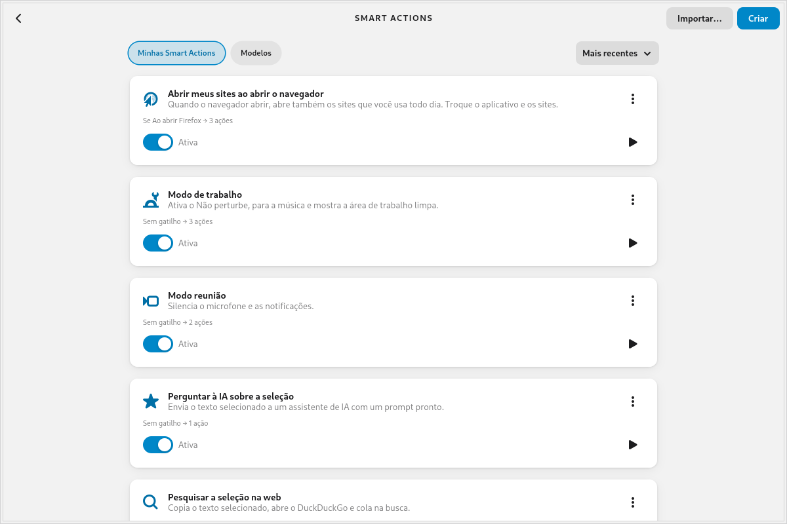<br>Smart Actions      |
| 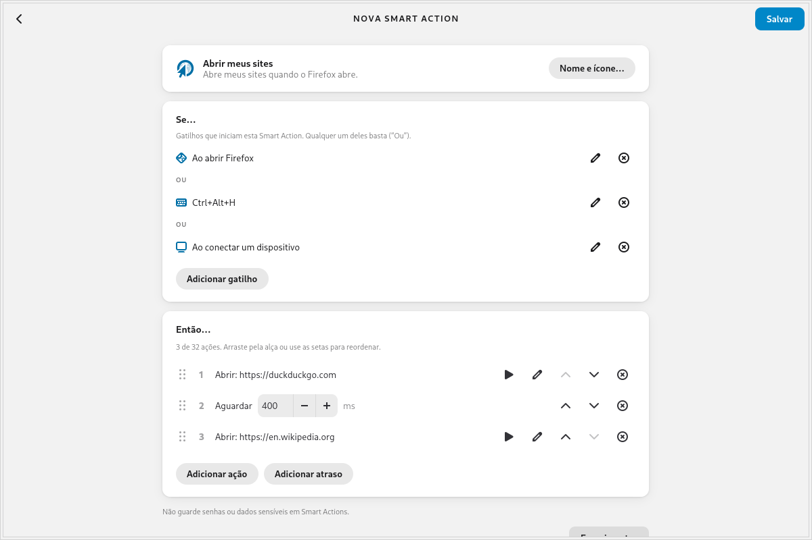<br>Smart Action editor | 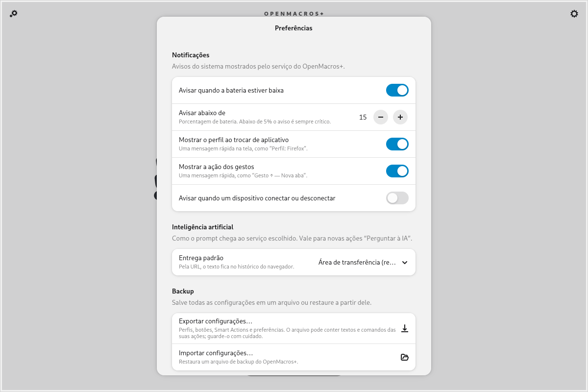<br>Preferences            |
| 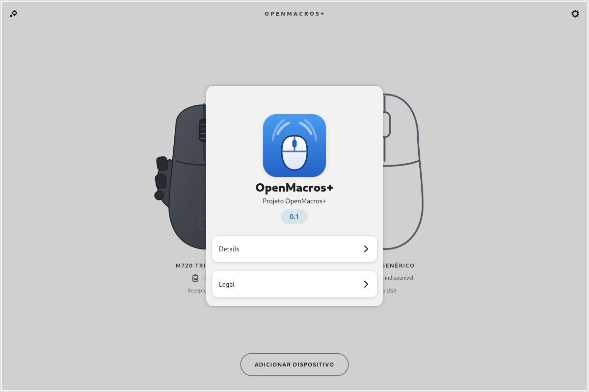<br>About tab                            | 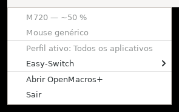<br>Tray icon and menu                   |

> The interface is currently in Brazilian Portuguese. Internationalization is planned (see [Roadmap](#roadmap)).

## Features

- **Buttons and remapping.** Reassign programmable buttons, including the gesture button.
- **Gestures.** Click plus four directions on the gesture button, with an adjustable sensitivity threshold.
- **Per-application profiles.** Each focused app can have its own button actions and pointer/scroll settings. Anything you do not set is inherited from "All applications". There is a built-in catalog of app suggestions that you apply only when you choose to.
- **Native actions:**
  - media (MPRIS), volume, window control (close, minimize, maximize, fullscreen, next/previous);
  - keyboard shortcuts, key sequences, mouse buttons, commands;
  - open an app, URL or file; control an app (open, close, focus);
  - type text (any Unicode, by pasting);
  - **AI with privacy:** ask Claude, ChatGPT, Perplexity or Gemini about the current selection. The prompt goes through the clipboard by default (see [Privacy and security](#privacy-and-security));
  - system: lock, screenshot, suspend, show desktop, mute microphone, Do Not Disturb (XFCE only), empty trash.
- **Smart Actions.** "If... Then..." automations. Triggers: a device button, a global keyboard shortcut, an app opening/closing/gaining focus, a device connecting/disconnecting. Up to 5 triggers and 32 steps (actions and delays). Ready-made templates, key recorder, export and import.
- **Point and scroll.** Pointer speed, DPI, hi-res scrolling, scroll inversion and SmartShift, where the device supports them. Can be overridden per app.
- **Easy-Switch.** Change channel from the window or from the tray.
- **Tray icon with battery.** Icon by lowest battery level, menu with devices, active profile and Easy-Switch.
- **Notifications and OSD.** Low battery, profile change, gesture fired, connect/disconnect.
- **Backup.** Export and import your configuration (merge or replace).

### Device images

The GUI uses its own vector art. It contains no Logitech material.

Optionally, you can import the official device photos locally. Use the home-screen menu item "Importar imagens do Logi Options+…" and point it at the official Logi Options+ installer that **you downloaded yourself**. The images are stored only on your computer, in `~/.local/share/openmacros/vendor`. They are never part of this repository.

## Supported devices

Only the Logitech M720 Triathlon (Bluetooth and Unifying) is tested on real hardware. Other HID++ 2.0 devices use a generic layout and may work, but are untested. See [docs/DEVICES.md](docs/DEVICES.md) for the list and how to contribute a new device.

## Requirements

- Linux with X11 (see [Limitations](#limitations))
- Python 3.12+
- GTK 4 + libadwaita, PyGObject
- python-evdev, pyudev, python-xlib
- `xclip` or `xsel` (clipboard and selection)
- Tray: GTK 3 + AyatanaAppIndicator3 (separate process)

Debian / Ubuntu / Kali:

```sh
sudo apt install python3 python3-gi gir1.2-gtk-4.0 gir1.2-adw-1 \
  python3-evdev python3-pyudev python3-xlib xclip xsel \
  gir1.2-gtk-3.0 gir1.2-ayatanaappindicator3-0.1
```

## Install

### Debian/Ubuntu/Kali (.deb)

Download `openmacros-plus_<version>_all.deb` from the [Releases](https://github.com/J3sussh/OpenMacros/releases) page and install it. `apt` pulls in the dependencies on its own:

```sh
sudo apt install ./openmacros-plus_<version>_all.deb
```

The package installs the udev rule and enables the `openmacrosd` user service for all users. **Log out and back in** (or reconnect the receiver/mouse) to start using it. Optionally verify the download against `SHA256SUMS` from the same release (`sha256sum -c SHA256SUMS`).

To remove it: `sudo apt remove openmacros-plus`. The package never touches your home directory, so `~/.config/openmacros` stays.

> If you installed from source with `scripts/install.sh` before, run `scripts/uninstall.sh` first. Otherwise the launchers in `~/.local/bin` take precedence in `PATH` over the packaged ones.

Build the package yourself with `packaging/deb/build-deb.sh` (see [CONTRIBUTING](CONTRIBUTING.md#building-the-deb-package)).

### From source

User-level install, no sudo. Only the udev rule needs sudo.

```sh
git clone https://github.com/J3sussh/OpenMacros.git
cd openmacros-plus
scripts/install.sh
```

`scripts/install.sh` options:

| Option | Effect |
|---|---|
| `--pipx` | Install with `pipx install --system-site-packages` instead of launchers |
| `--no-start` | Enable the `openmacrosd` service without starting it |
| `-h`, `--help` | Show help |

The script installs `openmacrosd`, `openmacros` and `openmacros-tray` in `~/.local/bin`, a systemd user unit, the `.desktop` file, the icon and two autostart entries (the tray, and a session helper that hands `DISPLAY`/`XAUTHORITY` to the service). It is idempotent. In the default mode the launchers run the code from the repository, so **do not move or delete the repository after installing**.

#### udev rule (hidraw and uinput access)

The script prints these commands but does not run them:

```sh
sudo install -m 644 data/udev/70-openmacros.rules /etc/udev/rules.d/70-openmacros.rules
sudo udevadm control --reload-rules && sudo udevadm trigger --subsystem-match=hidraw --subsystem-match=misc
```

Then reconnect the receiver/mouse or log in again. The `uaccess` tag gives the logged-in user access to the HID++ hidraw node and to `/dev/uinput` (needed for keyboard and mouse actions).

The rule covers Bluetooth and USB receivers (Unifying, Bolt, Lightspeed, Nano). Wired USB devices are not covered; see the comments in `data/udev/70-openmacros.rules`.

## Uninstall

```sh
scripts/uninstall.sh            # remove launchers, unit, .desktop, icon, autostart
scripts/uninstall.sh --purge    # also delete ~/.config/openmacros
sudo rm /etc/udev/rules.d/70-openmacros.rules   # the script does not remove the udev rule
```

## Quick start

```sh
openmacros                              # graphical interface
openmacros-tray                         # tray icon (starts at login after install)
systemctl --user status openmacrosd     # the service that talks to the device
```

1. Open OpenMacros+ and pick your device.
2. On the BOTÕES tab, click a button on the image and choose an action.
3. For a per-app profile, use the "+" above the image.

More in the [user guides](docs/guide/getting-started.md).

No hardware? Run with simulated devices:

```sh
OPENMACROS_FAKE=1 openmacrosd
openmacros   # in another terminal
```

Environment variables: `OPENMACROS_FAKE=1`, `OPENMACROS_LOG=DEBUG`, `OPENMACROS_CONFIG=/path/config.json` (default `~/.config/openmacros/config.json`).

## Privacy and security

- **AI by clipboard.** By default the prompt (your selection plus your template) is copied to the clipboard, the service's home page opens, and you paste with Ctrl+V. Nothing goes in the URL. URL delivery (`?q=`) is optional, and the URL stays in your browser history. Gemini always uses the clipboard. OpenMacros+ never sends data to any service on its own.
- **Secret detector.** If the selection looks like a secret (JWT, AWS/GitHub/Slack keys, private keys, `Bearer` tokens, `password=`, hashes, long tokens), URL delivery is blocked and the prompt goes through the clipboard with a warning. The detector is **heuristic**. It can be wrong both ways. Do not treat it as a guarantee.
- **D-Bus.** The service only accepts calls from the same user id. Callers inside a Flatpak sandbox are limited to read-only methods.
- **Smart Actions** run commands and keystrokes. Do not store passwords in them. Imported Smart Actions start disabled.

To report a vulnerability, see [SECURITY.md](SECURITY.md).

## Limitations

- **Per-app profiles and app-based triggers work only on X11.** On Wayland the focused app is not detected, so only the global profile applies. Wayland support is planned.
- **Global shortcut triggers** use X11 key grabs and are unavailable on Wayland.
- **Type text, "Simular teclas" mode:** US layout only. The default mode (paste) accepts any Unicode, and temporarily uses the clipboard.
- Wired USB devices have no ready-made udev rule.
- Only the M720 Triathlon is tested on real hardware.

## Roadmap

Planned or under study. No dates, no promises.

- Actions Ring
- Spotlight-style effects
- Marketplace for Smart Actions and profiles
- Experimental haptics support
- Interoperability with Flow (research)
- More devices
- Internationalization (i18n) of the interface
- Wayland support

## Architecture

Two processes plus a tray, connected by the session D-Bus (`io.github.openmacros`):

- `openmacrosd`: user service. Speaks HID++ over hidraw and runs actions through uinput.
- `openmacros`: GTK4/libadwaita GUI. Talks to the service only over D-Bus.
- `openmacros-tray`: tray icon, separate process (GTK 3 + AyatanaAppIndicator3).

Configuration lives in `~/.config/openmacros/config.json` and is reapplied on every reconnect. See [docs/ARCHITECTURE.md](docs/ARCHITECTURE.md) and the [documentation index](docs/README.md).

## Development

```sh
OPENMACROS_FAKE=1 PYTHONPATH=src python3 -m openmacros.daemon.main   # service with simulated devices
PYTHONPATH=src python3 -m openmacros.gui                             # GUI, in another terminal
xvfb-run -a dbus-run-session -- python3 -m pytest -q                 # full test suite
```

Tests use a simulated HID++ transport, so they need no hardware. For the GUI tests, install `xvfb`, `dbus` and `pytest`. CI (GitHub Actions, Ubuntu 24.04, system Python 3.12) runs the same pytest command plus `compileall`, `bash -n` and `shellcheck`. Details in [CONTRIBUTING.md](CONTRIBUTING.md).

## Contributing

Bug reports, device reports and pull requests are welcome. Read [CONTRIBUTING.md](CONTRIBUTING.md) first. The project follows a clean-room policy: do not contribute code, images or text from Logitech. Everyone is expected to follow the [Code of Conduct](CODE_OF_CONDUCT.md).

## License

[GPL-3.0-or-later](LICENSE).

## Trademarks

Logitech, Logi, Options+, MX, Triathlon and other names are trademarks of their respective owners. They appear here only to indicate compatibility. This project is not affiliated with, endorsed by or sponsored by Logitech.
